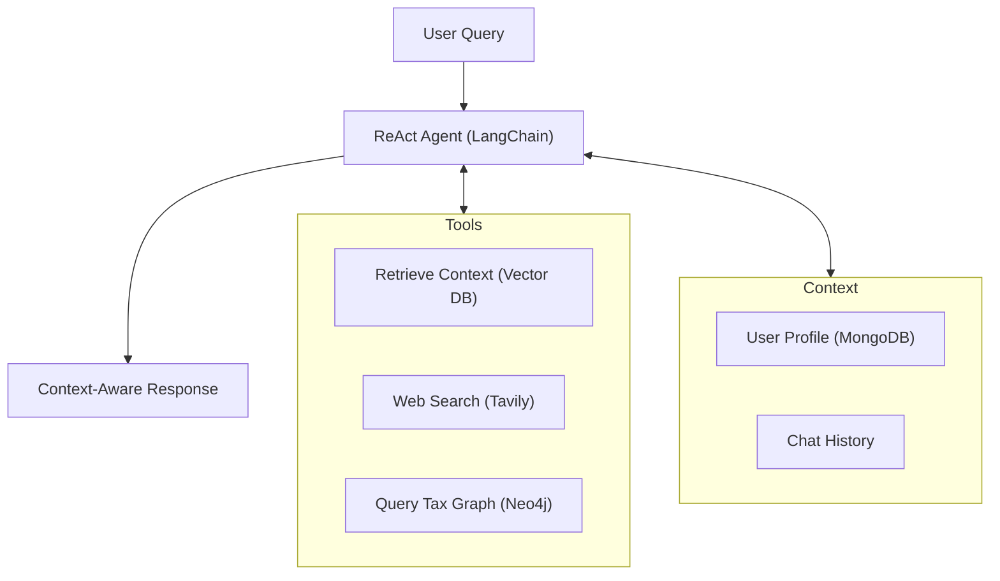

# AI Advisor Architecture 🤖

The TaxMate Advisor is a **Retrieval-Augmented Generation (RAG)** system powered by LangChain. It acts as a specialized domain expert that can answer user queries by combining general intelligence with specific legal context (Indian Income Tax Act) and the user's personal financial data.

## 1. Core Concept

Can generic LLMs (like GPT-4) advise on tax? Sometimes. But they lack:
1.  **Specific Knowledge**: Updates from the latest budget or specific Section 80 conditions.
2.  **Context**: They don't know the user's salary, deductions, or regime.
3.  **Reliability**: They can hallucinate rules.

Our Advisor solves this by injecting *Ground Truth* context into every prompt.

## 2. Architecture

## 3. The ReAct Agent

We use a **ReAct (Reasoning + Acting)** agent structure. This allows the AI to "think" before answering.

*   **Thought**: "The user is asking about tax saving. I need to know their current income and what deductions they already claimed."
*   **Action**: `retrieve_context("Section 80C limits")`
*   **Observation**: "Section 80C limit is ₹1.5 Lakh."
*   **Thought**: "Now I check their Form 16."
*   **Action**: (Internal Context Lookups)
*   **Final Answer**: "You have only claimed ₹50,000 in 80C. You can invest another ₹1,00,000 in PPF to save approx ₹30,000 in tax."

## 4. Tools & Capabilities

### 4.1 `retrieve_context` (Vector Store)
*   **Source**: A ChromaDB/Qdrant vector store indexed with the Indian Income Tax Act (Chapter VI-A).
*   **Usage**: Used to lookup static rules like "What is the age limit for 80D senior citizens?".

### 4.2 `web_search` (Tavily Search API)
*   **Source**: Live internet search optimized for AI agents.
*   **Usage**: Used for temporal queries like "What are the new tax slabs for FY 2025-26?" or "Latest budget news".
*   **Fail-safe**: Acts as a fallback if the RAG system fails or finds no relevant documents.

### 4.3 `query_tax_graph` (Knowledge Graph)
*   **Source**: A Neo4j graph database representing relationships between Tax Sections.
*   **Usage**: Used for complex queries like "If I claim HRA, can I also claim 80GG?".

## 5. Model Configuration
*   **LLM Provider**: OpenRouter (accessing DeepSeek/Llama 3) or OpenAI (GPT-4o).
*   **Temperature**: Set to `0` for maximum determinism and fact-based answers.
