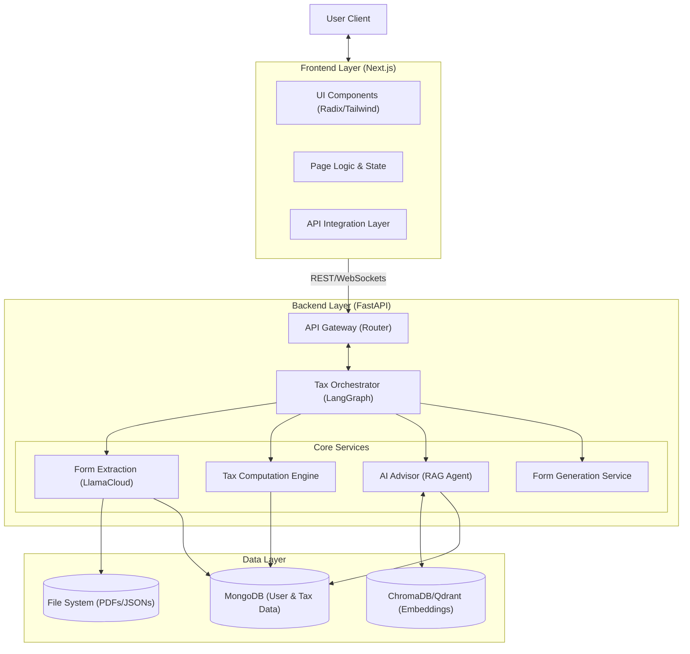
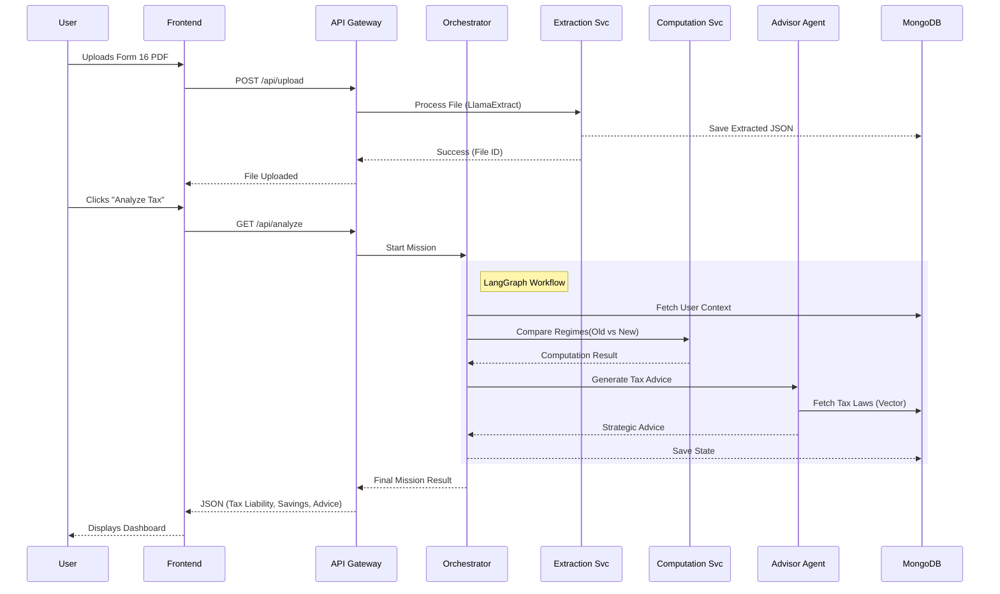

# TaxMate System Architecture

## 1. High-Level Design (HLD)

The TaxMate system follows a modern, decoupled architecture separating the User Interface (Next.js) from the business logic and AI orchestration (FastAPI + LangGraph). This allows for independent scaling and maintenance of the frontend and backend components.

### 1.1 System Diagram

## 2. Core Components

### 2.1 Frontend (User Interface)
*   **Tech Stack**: Next.js 13+, React, Typescript, Tailwind CSS.
*   **Responsibility**: provides the interactive dashboard for file uploads, chat interface, and result visualization.
*   **Communication**: detailed in [Frontend Architecture](FRONTEND_ARCHITECTURE.md).

### 2.2 Backend (Orchestration & Logic)
*   **Tech Stack**: Python 3.10+, FastAPI, LangGraph, LangChain.
*   **Responsibility**: Acts as the brain of the system. It exposes REST endpoints and manages the long-running workflows for tax filing.
*   **Orchestrator**: A state-machine based workflow engine that coordinates data flow between extraction, computation, and advisory. Detailed in [Orchestrator Architecture](ORCHESTRATOR_ARCHITECTURE.md).

### 2.3 Data Services
*   **MongoDB**: Primary transactional database. Stores User profiles, extracted form data (Form 16/AIS), and ITR filing status.
*   **Vector DB**: Stores semantic embeddings of the Income Tax Act and user documents to support the RAG (Retrieval Augmented Generation) based Tax Advisor.

### 2.4 End-to-End Sequence Diagram

The following diagram illustrates the interaction between components during a typical tax analysis request.

## 3. Key Workflows

### 3.1 The Filing Workflow (The "Mission")
1.  **Ingestion**: User uploads PDF documents.
2.  **Extraction**: System converts PDFs to structured JSON (Form 16/AIS schemas).
3.  **Computation**: Engine calculates tax under Old vs. New regime.
4.  **Advisory**: AI analyzes the financial situation to suggest tax saving opportunities.
5.  **Generation**: System produces the final ITR JSON for filing.

### 3.2 The Advisory Workflow
1.  User asks a question (e.g., "How can I save more tax?").
2.  **Retrieval**: System fetches relevant user financial data (Context) and Tax Law sections (Knowledge).
3.  **Reasoning**: LLM Agent plans a response, potentially searching the web for latest updates.
4.  **Response**: AI delivers a personalized, cited answer.

## 4. Design Principles
*   **Modularity**: Each service (Extraction, Computation) is independent and testable.
*   **Statelessness**: The API layer is stateless; state is managed by the Database and the Orchestrator's checkpointing mechanism.
*   **Security**: PII (Personally Identifiable Information) is handled with strict access controls. See [Security Documentation](SECURITY.md).
