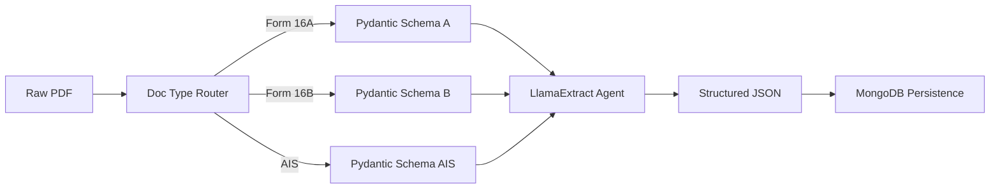

# Form Extraction Architecture 📄

The Form Extraction module is responsible for converting unstructured and semi-structured PDF documents (Form 16, AIS) into strictly typed JSON data that the computation engine can process.

## 1. Overview

We utilize **LlamaCloud (LlamaExtract)** as the core extraction engine. This provides a significant advantage over traditional OCR or heuristic-based parsers by understanding the *semantic structure* of tax documents, even when layouts vary between employers.

## 2. Supported Documents

| Document Type | Source | Logic |
| :--- | :--- | :--- |
| **Form 16 Part A** | TRACES | Extracts Employer PAN, Address, Tax Deducted at Source (TDS). |
| **Form 16 Part B** | Employer | Extracts detailed Salary breakdown, HRA, Standard Deduction, Chapter VI-A deductions. |
| **AIS** | Income/Tax Dept | Extracts "Annual Information Statement" data including Interest, Dividends, and Stock sales. |

## 3. The Pipeline

The extraction process follows a linear pipeline:



### 3.1 Document Type Detection
Before extraction, the system identifies the document type based on filename heuristics (`form16a`, `part_b`, `ais`). This directs the file to the correct Pydantic schema.

### 3.2 LlamaExtract Integration
*   **Agent Creation**: For each file, a temporary extraction agent is created in LlamaCloud defined by the specific Pydantic schema.
*   **Execution**: The file is uploaded and processed by LlamaCloud's LLM-based parser.
*   **Validation**: The output is validated against the schema to ensure all required fields (e.g., `gross_salary`, `pan_number`) are present and of the correct type (float/string).

### 3.3 Data Persistence
Extracted data is saved in two locations:
1.  **JSON Backup**: A raw JSON file is saved in `app/data/extracted/` for debugging.
2.  **MongoDB**: The validated data is stored in the respective collection (`form16_part_as`, `form16_part_bs`, `ais`) linked to the `user_id`.

## 4. Key Schemas

### `Form16PartB_Schema`
The most critical schema for tax calculation.
```python
class EmployerDetails(BaseModel):
    name: str | None
    pan: str | None
    tan: str | None

class SalaryDetails(BaseModel):
    section_17_1_gross_salary: float
    section_17_2_perquisites: float
    section_17_3_profits_in_lieu: float
    total_salary: float
    standard_deduction: float

class DeductionsChapterVIA(BaseModel):
    section_80c: float
    section_80d: float
    section_80e: float
    section_80g: float
    total_deductions_via: float
```
