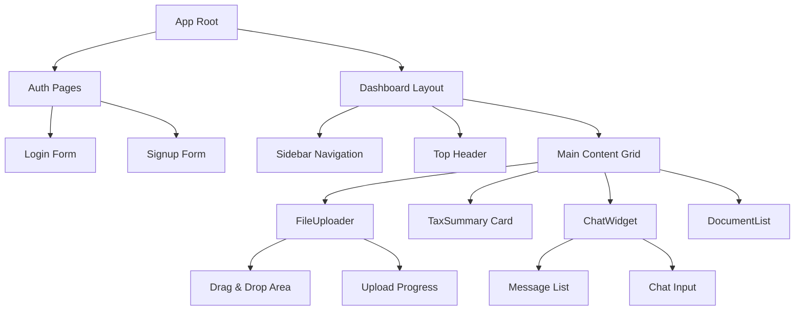

# Frontend Architecture 🖥️

The TaxMate frontend is a modern **Next.js** application built for speed, responsiveness, and a premium user experience. It serves as the interface for users to manage their tax documents, view calculated insights, and interact with the AI advisor.

## 1. Technology Stack

*   **Framework**: Next.js 13+ (App Router)
*   **Language**: TypeScript
*   **Styling**: Tailwind CSS
*   **UI Primitives**: Radix UI (Headless accessible components)
*   **State Management**: React Hooks (SWR/Context) & URL State
*   **Icons**: Lucide React
*   **Notifications**: Sonner

## 2. Directory Structure

```plaintext
frontend/
├── app/                    # Next.js App Router
│   ├── dashboard/          # Main Application View
│   │   ├── page.tsx        # Dashboard Layout & Grid
│   │   └── layout.tsx      # Sidebar/Header Wrapper
│   ├── auth/               # Authentication Routes (Login/Signup)
│   ├── layout.tsx          # Root Layout
│   └── globals.css         # Global Styles & Tailwind Directives
│
├── components/             # Reusable UI Components
│   ├── ui/                 # Shadcn/Radix UI Primitives (Button, Card, etc.)
│   ├── dashboard/          # Feature-Specific Widgets
│   │   ├── TaxSummary.tsx     # Tax Regime Comparison Card
│   │   ├── FileUploader.tsx   # Drag-and-Drop Area
│   │   └── ChatWidget.tsx     # AI Advisor Chat Interface
│   └── shared/             # Shared Elements (Header, Sidebar)
│
├── lib/                    # Utilities
│   ├── utils.ts            # CN/Tailwind Helper
│   └── api.ts              # API Client (Fetch Wrapper)
│
└── public/                 # Static Assets
```

## 3. Component Hierarchy

The application consists of several key functional trees.



## 3. Key Modules

### 3.1 Dashboard Module (`app/dashboard`)
The dashboard is the central hub designed with a "Grid Layout" to show efficient information at a glance.
*   **Regime Comparison**: Visualizes the tax liability difference between Old and New regimes using charts and summary cards.
*   **Document Management**: Lists uploaded files (Form 16, AIS) with their status (Uploaded, Processed, error).
*   **File Upload**: A resilient drag-and-drop zone that handles file type validation and uploads to the backend.

### 3.2 Chat Interface
*   **Real-time Interaction**: A chat widget allowing users to ask "How can I save tax?".
*   **Context Aware**: The chat interface maintains session history and displays citations provided by the backend.

## 4. State Management Strategy

*   **Server State (SWR/React Query)**: Used for fetching asynchronous data like tax calculation results (`/api/analyze`) and user profile. This ensures data freshness and caching.
*   **Local State (useState)**: Used for UI interactions like modal open/close, active tab selection.
*   **URL State**: Used for shareable states where applicable (though primarily a protected dashboard).

## 5. API Integration

The frontend communicates with the backend via the `api/` directory proxies or direct calls.
*   **Authentication**: JWT-based auth flow stored in HttpOnly cookies/local storage.
*   **File Upload**: `FormData` based uploads to `/api/upload`.
*   **WebSockets**: (Optional) For real-time updates on long-running extraction tasks.

## 6. Design System

We use a "Premium" design aesthetic:
*   **Palette**: Dark mode focused (Slate/Zinc) with vibrant accents (Blue/Green) for financial positive indicators.
*   **Typography**: Clean sans-serif (Inter/Geist) for readability of financial numbers.
*   **Components**: Based on Shadcn UI for consistency and accessibility.
