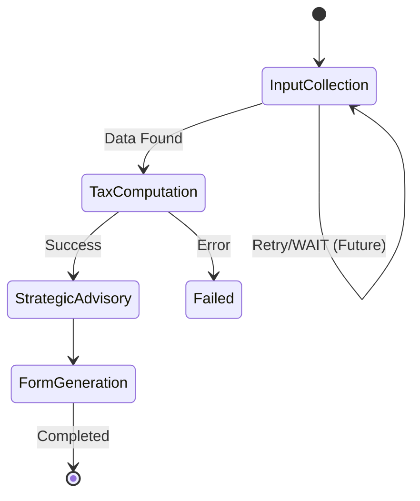

# Orchestrator Architecture 🧠

The Orchestrator is the central brain of TaxMate, responsible for coordinating the multi-step process of tax filing. It uses **LangGraph** to define a deterministic state machine that guides the data from raw inputs to a final, filed return.

## 1. Overview

Unlike traditional linear scripts, the Orchestrator implements a **State Machine** pattern. This allows:
*   **Resiliency**: The workflow can pause, resume, or retry steps.
*   **State Management**: A shared state object (`AgentState`) is passed between nodes, ensuring all steps have access to the full context.
*   **Determinism**: Defined transitions ensure the workflow follows specific business rules (e.g., *Cannot compute tax without extracting data first*).

## 2. The `AgentState`

The shared state dictionary is the backbone of the Orchestrator.

```python
class AgentState(TypedDict):
    mission_id: str           # Unique ID for the workflow run
    user_id: str             # ID of the user context
    user_query: str          # Initial user intent
    extracted_data: Dict     # JSON data from Form 16/AIS
    computation_result: Dict # Output of Old vs New comparison
    advisory_result: str     # AI Generated advice
    filling_result: Dict     # Path to generated ITR JSON
    errors: List[str]        # Log of any failures
    status: str              # Current status (INIT, COMPUTED, FAILED)
```

## 3. Workflow Nodes

### 3.1 `input_collection_node`
*   **Goal**: Gather all necessary financial data.
*   **Logic**:
    1.  Checks MongoDB for existing `Form16PartA`, `Form16PartB`, or `AIS` records for the user.
    2.  If data is missing, it triggers the `extract_all_forms` service to process any pending PDFs in the input directory.
    3.  Updates `state["extracted_data"]` and transitions to `compute_tax_node`.

### 3.2 `compute_tax_node`
*   **Goal**: Calculate tax liability.
*   **Logic**:
    1.  Receives extracted data.
    2.  Invokes `TaxComparisonService.compare_tax_regimes()`.
    3.  Runs rules for Old Regime (standard deduction, 80C, HRA) and New Regime (new slabs, 87A rebate).
    4.  Updates `state["computation_result"]` with the comparison and optimal choice.

### 3.3 `strategic_advisory_node`
*   **Goal**: Provide value-add insights.
*   **Logic**:
    1.  Analyzes the `computation_result` (e.g., "Optimal: Old Regime, Savings: ₹12,000").
    2.  Uses an LLM agent to generate personalized advice (e.g., "You maximized 80C but missed 80CCD(1B)").
    3.  Updates `state["advisory_result"]`.

### 3.4 `form_generation_node`
*   **Goal**: Create compliance documents.
*   **Logic**:
    1.  Takes the final computed values.
    2.  Maps them to the official ITR-1 Schema.
    3.  Generates a valid JSON file and persists it to the `ITR` collection in MongoDB.

## 4. Graph Flow



## 5. Error Handling

The Orchestrator employs a "Fail-Fast but Log" strategy.
*   If a critical node (Input, Computation) fails, the status is set to `FAILED` and the workflow terminates early.
*   Non-critical nodes (Advisory) catch their own exceptions, log warnings, and allow the workflow to proceed to the next step, ensuring the core filing capability is not blocked by auxiliary AI failures.
