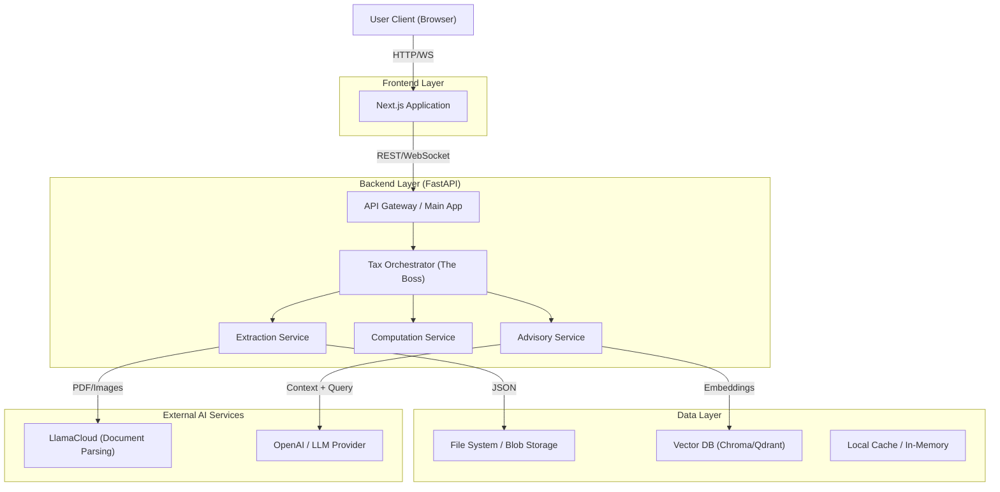
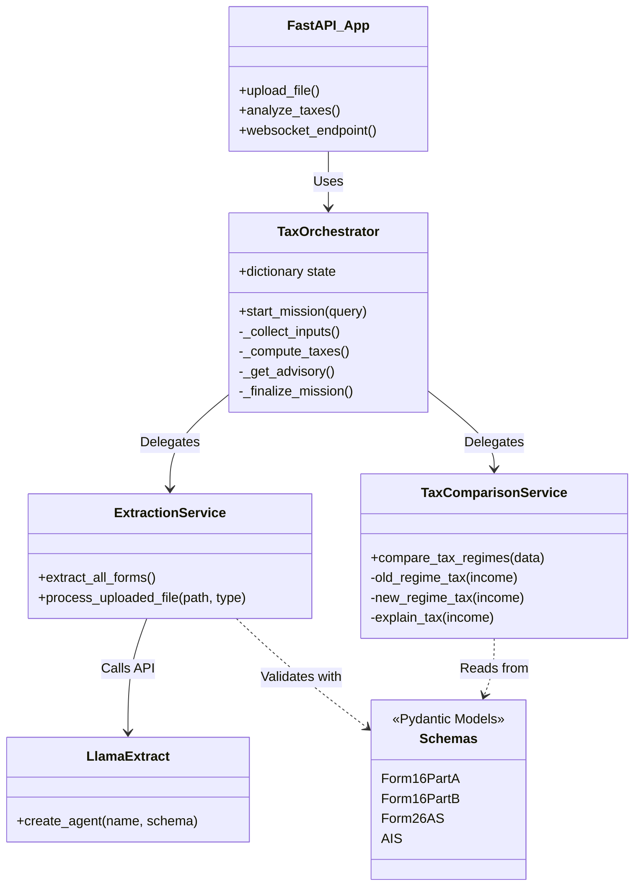
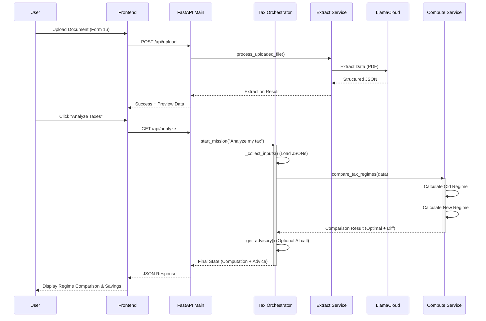

# TaxMate Project Overview

## Current Functionalities

### 1. 📄 Intelligent Document Processing
- **Upload & Extract**: Users can upload tax documents like **Form 16 (Part A & B)**, **Form 26AS**, and **AIS (Annual Information Statement)**.
- **Extraction Engine**: Uses `LlamaExtract` (LlamaCloud) to intelligently parse these PDFs into structured JSON data.

### 2. 🧮 Automated Tax Computation & Comparison
- **Regime Analysis**: Automatically calculates tax liability under both the **Old Regime** and **New Regime** (using FY 2025-26 slabs).
- **Optimization**: Compares the two to recommend the optimal tax regime for the user, highlighting specific savings.
- **Detailed Breakdown**: Provides a step-by-step explanation of the calculation (Standard Deduction, Slabs, Cess, etc.).

### 3. 🤖 AI Tax Advisory
- **Context-Aware Chat**: A "Tax Advisor" chatbot that users can interact with. It uses the extracted data (income, deductions like 80C, 80D) to provide personalized answers.
- **Orchestrator**: A central "Boss" agent (`TaxOrchestrator`) that manages the flow between data collection, computation, and advisory steps.

### 4. 💻 Modern Web Interface
- **Frontend**: A **Next.js 13+** application with a responsive design using **Tailwind CSS** and **Radix UI**.
- **Features**: Dashboard for file management, visualization of tax data, and a chat interface.

---

# TaxMate Design Documentation

## 1. High-Level Design (HLD)

### 1.1 System Architecture

The system follows a modern microservices-lite architecture with a clear separation between the frontend User Interface and the backend API services. It leverages external AI services for heavy lifting in document processing and reasoning.



### 1.2 Core Components

1.  **Frontend (Next.js)**: 
    -   Handles user interaction, file uploads, and chat interface.
    -   Communicates with backend via REST API (uploads) and WebSockets (chat).
    -   State management for user session and document status.

2.  **Backend (FastAPI)**:
    -   **API Gateway**: Exposes endpoints for `upload`, `analyze`, and `websocket`.
    -   **Tax Orchestrator**: The central controller that manages the workflow state machine (Init -> Extract -> Compute -> Advise).
    -   **Extraction Service**: Interfaces with LlamaCloud to convert PDF Tax Forms (Form 16, AIS) into structured Pydantic models.
    -   **Computation Service**: Pure logic component that implements Indian Tax Law rules (New vs. Old Regime) to calculate liabilities.
    -   **Advisory Service**: RAG (Retrieval-Augmented Generation) based agent that answers user queries using the extracted financial context.

3.  **Data Storage**:
    -   **File System**: Stores raw PDFs and extracted JSONs.
    -   **Vector DB**: Stores embeddings of tax documents for semantic search (used by Advisory service).

---

## 2. Low-Level Design (LLD)

### 2.1 Backend Class Diagram

This diagram details the core Python classes and their relationships within the `src` directory.



### 2.2 Sequence Diagram: Critical User Flow (Upload & Analyze)

This sequence illustrates the flow when a user uploads a document and requests an analysis.



### 2.3 Data Models (Key Pydantic Structures)

The system relies heavily on strict typing for the semi-structured tax forms.

**Form 16 Part B Structure (Simplified):**
```python
class Form16PartB(BaseModel):
    employer_details: EmployerDetails
    salary_details: SalaryDetails
        - total_salary: float
        - perquisites: float
    deductions_chapter_VIA: DeductionsChapterVIA
        - section_80C: float
        - section_80D: float
    tax_computation: TaxComputation
        - total_tax_liability: float
```

**Tax Comparison Result:**
```python
class ComparisonResult(TypedDict):
    gross_salary: float
    old_tax: float
    new_tax: float
    optimal_regime: str  # "OLD" | "NEW"
    detailed_explanation: str
```
