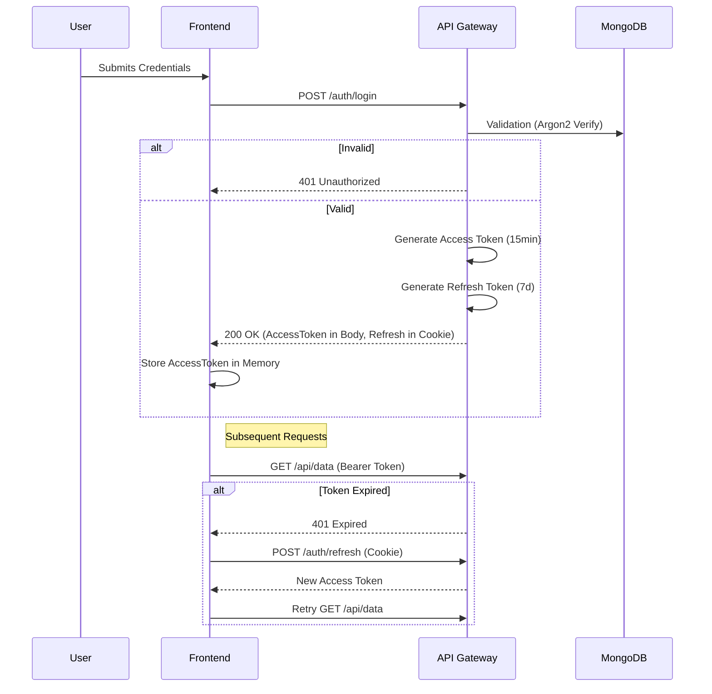

# Security & Privacy 🔒

Dealing with sensitive financial documents like Form 16 and PAN requires robust security measures. TaxMate is designed with "Security First" principles to ensure user data privacy and integrity.

## 1. Data Protection

### 1.1 In-Transit Encryption
*   All communication between the Client (Browser) and Server is encrypted via **TLS 1.2+ (HTTPS/WSS)**.
*   Internal communication between services (when deployed in a cluster) uses mTLS where supported.

### 1.2 At-Rest Encryption
*   **Database**: Critical fields (PAN, Phone) in MongoDB are encrypted at the field level (future scope) or rely on volume-level encryption (e.g., AWS EBS encryption or MongoDB Enterprise Encryption).
*   **Passwords**: User passwords are **never** stored in plain text. We use `Argon2` (via Passlib) for strong hashing, which is resistant to GPU-based brute-force attacks.

## 2. Authentication & Authorization

### 2.1 JWT (JSON Web Tokens)
*   The system uses stateless JWTs for session management.
*   **Access Token**: Short-lived (15 minutes).
*   **Refresh Token**: Long-lived (7 days), stored in an `HttpOnly`, `Secure` cookie to prevent XSS attacks.

### 2.1.1 Authentication Flow

### 2.2 Role-Based Access Control (RBAC)
*   **User**: Can only access their own documents and tax filings. Middleware verifies that `request.user.id == resource.user.id`.
*   **Admin**: (Future Scope) Can view system health metrics but **cannot** view user tax data without explicit consent audit logs.

## 3. PII Handling (Personally Identifiable Information)

*   **Extraction Privacy**:
    *   Documents sent to LlamaCloud are processed in an ephemeral environment. We rely on LlamaIndex's enterprise data privacy commitments.
    *   No user data is used to train public models.

*   **Minimization**:
    *   We only extract fields necessary for tax computation (Salary, PAN, TDS).
    *   We do not store the original PDF indefinitely; users can optionally auto-delete source files after extraction.

## 4. Secure Development Lifecycle (SDLC)

*   **Dependency Scanning**: Automated checks (e.g., `npm audit`, `safety check`) in CI/CD pipelines to detect vulnerable libraries.
*   **Input Validation**: Strict **Pydantic** schemas prevent Injection attacks (SQLi, NoSQLi) by validating all incoming data before it touches the database.
*   **Logging**: Logs are sanitized to ensure no PII (like PAN or Passwords) is written to disk.

## 5. Deployment Security

*   **Cors Policy**: Restricted to trusted frontend domains.
*   **Rate Limiting**: Implemented on the API Gateway (FastAPI Limiter) to prevent DDoS and Brute-force login attempts.
